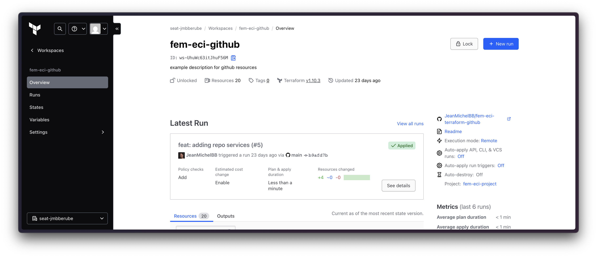

# fem-eci-terraform-github



## Overview
This repository automates the management of GitHub resources using Terraform. It is part of a larger infrastructure automation project.

## Features
- Automates GitHub repository creation and configuration
- Uses Terraform to manage GitHub settings
- Supports multiple repositories with different configurations

## Requirements
- Terraform installed on your local machine
- GitHub Personal Access Token with the necessary permissions

## Setup
1. Clone the repository:
   ```sh
   git clone https://github.com/yourusername/fem-eci-terraform-github.git
   ```
2. Navigate to the project directory:
   ```sh
   cd fem-eci-terraform-github
   ```
3. Initialize Terraform:
   ```sh
   terraform init
   ```
4. Plan the changes:
   ```sh
   terraform plan
   ```
5. Apply the changes:
   ```sh
   terraform apply
   ```

## Repository Configuration
The repository configuration is managed in `locals.tf` and includes details like visibility, topics, and descriptions for each repository.

## Contributing
If you want to contribute to this project, please submit a pull request with your changes.

## License
This project is licensed under the MIT License.